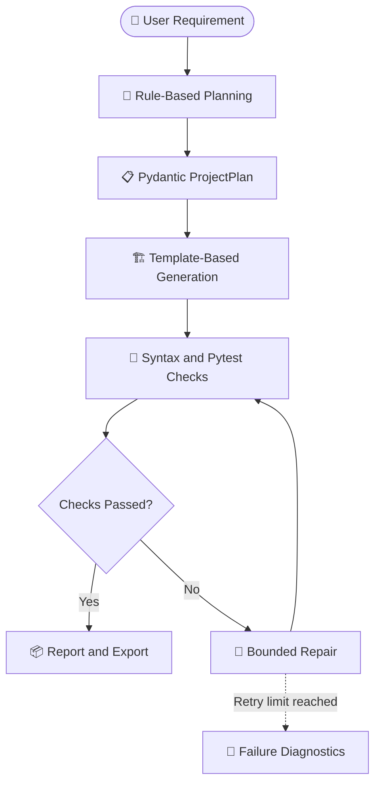
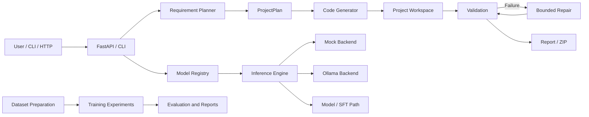

 
<div align="center">

# ⚡ CodeForge AI

### Autonomous Coding Agent · CodeForge-H · AI Software Engineering

<p>
  
</p>

<p>
  
  
  
  
  
</p>

**An experimental platform for requirement-driven project generation, code validation, bounded repair, and coding-language-model research.**

[Repository](https://github.com/priyan1436ei-lab/-CodeForge-AI-CodeForge-H) · [Issues](https://github.com/priyan1436ei-lab/-CodeForge-AI-CodeForge-H/issues) · [Model Card](./MODEL_CARD_27B.md) · [Data Card](./DATA_CARD.md)

</div>

---

## 🧭 Contents

- [Overview](#-overview)
- [Actual Source Code Analysis](#-actual-source-code-analysis)
- [Features](#-features)
- [Animated Workflow](#-animated-workflow)
- [System Architecture](#-system-architecture)
- [API Endpoints](#-api-endpoints)
- [CodeForge-H Model](#-codeforge-h-model)
- [Dataset and Training Pipeline](#-dataset-and-training-pipeline)
- [Environment and Prerequisites](#-environment-and-prerequisites)
- [Quickstart](#-quickstart)
- [CLI Usage](#-cli-usage)
- [Testing and Evaluation](#-testing-and-evaluation)
- [Security and Limitations](#-security-and-limitations)
- [Repository Structure](#-repository-structure)
- [Roadmap](#-roadmap)
- [Contributing](#-contributing)
- [License](#-license)

---

## 🚀 Overview

**CodeForge AI** is a Python-based experimental software-engineering agent paired with a coding-model research workspace named **CodeForge-H**.

The project combines a requirement planner, multi-file project generator, FastAPI backend, validation and repair workflow, inference engine, model registry, and PyTorch model experiments.

The objective is to move beyond isolated code snippets towards a structured workflow that records what was planned, which files were generated, which checks ran, and whether the operation succeeded.

### Two connected areas

| Component | Purpose |
|---|---|
| **CodeForge AI Agent** | Requirement planning, project generation, validation, repair, and export |
| **CodeForge-H** | Coding-model architecture experiments, data preparation, training workflows, and evaluation |

> [!IMPORTANT]
> This is an experimental codebase. Model architecture definitions, pipeline scripts, test results, and claims of completed large-scale training are different types of evidence. Benchmark scores and training claims should be treated as verified only when the corresponding checkpoint, logs, exact configuration, and evaluation procedure can be reproduced.

---

## 🔬 Actual Source Code Analysis

This section describes what the inspected source files actually implement, rather than simply repeating feature claims.

| Source file | Implementation |
|---|---|
| `agent/planner/planner.py` | Parses natural-language requirements using keyword-based rules and creates a Pydantic project plan |
| `packages/shared/types.py` | Defines shared request, project-plan, file-manifest, validation, repair, model-registry, and token-ledger schemas |
| `agent/generator/generator.py` | Builds project files from predefined templates, writes them to a workspace, and supports project artifact packaging |
| `serve/pipeline.py` | Coordinates planning, generation, validation, bounded repair, and the final pipeline result |
| `apps/api/main.py` | Exposes REST endpoints for projects, models, datasets, training, evaluation, token usage, and event streaming |
| `cli/codeforge.py` | Provides CLI operations for planning, generation, validation, repair, model listing, training experiments, evaluation, and hardware reports |
| `ml/inference/engine.py` | Routes inference requests through configured backend paths, including mock and Ollama-oriented execution, and records token/latency estimates |
| `ml/model_registry/registry.py` | Maintains model metadata and performs hardware-feasibility checks |
| `model/hybrid_transformer.py` | Implements a PyTorch hybrid decoder experiment with DeltaNet-style blocks and attention layers |
| `model/deltanet_reference.py` | Provides a DeltaNet reference implementation |
| `ml/training/pretraining/model.py` | Implements a separate decoder-only transformer configuration with GQA, RoPE, RMSNorm, SwiGLU, and an auxiliary MTP head |
| `agent/execution/sandbox.py` | Executes commands with timeout and output controls |
| `agent/repair/repair.py` | Validates generated backend files and attempts bounded repair |
| `scripts/run_autonomous_pipeline.py` | Coordinates the documented data, training, evaluation, checkpoint, integration, and reporting phases |

### Important implementation findings

- The planner is primarily **keyword/rule-based**. It is not a fully semantic LLM planner.
- The generator contains **predefined project templates**, including an expense-oriented backend example. Its inspected generation path builds file contents from templates; importing an inference engine does not itself prove that every generated file is produced by the custom model.
- The inference engine includes a mock fallback. A mock-backed successful workflow demonstrates orchestration behavior, not custom-model coding quality.
- The repository contains custom model code and a 27B training target. These do not by themselves prove that a custom 27B model has been fully trained.
- The recorded environment describes a CPU-only PyTorch build with CUDA unavailable in that Python environment. Verify the active runtime before attempting GPU-dependent training.

These distinctions are important for accurately describing the project's current maturity.

---

## ✨ Features

### 🧩 Requirement-to-plan workflow

The planner converts a natural-language request into a structured project plan containing:

- Project ID and name
- Frontend, backend, and database selections
- Feature list
- Requirements and acceptance criteria
- Security and testing requirements
- Clarification questions
- Creation timestamp

Stack selection currently uses explicit rules and can be overridden through a preferred-stack input. The resulting plan should be reviewed before implementation.

### 🏗️ Multi-file project generation

The generator creates a project workspace and returns a file manifest. Its templates include a README, environment example, backend dependency file, FastAPI application, and tests.

Generated output should be reviewed for missing functionality, dependencies, inconsistent interfaces, and insecure defaults. A generated scaffold is not automatically a complete production application.

### 🧪 Validation and repair

The intended workflow is:

1. Generate project files.
2. Run available syntax checks and tests.
3. Collect diagnostic output.
4. Attempt a bounded repair if validation fails.
5. Return the final status and unresolved errors.

A successful result only demonstrates that the checks which actually ran passed.

### 🧠 Model registry and inference

The model registry stores metadata such as model ID, architecture, parameter count, context length, precision, backend, and estimated VRAM.

The inference engine contains mock and Ollama-oriented paths, as well as a model/SFT-oriented path. Actual checkpoint availability and fallback behavior must be verified for the chosen configuration.

### 📊 Dataset and training workflows

The repository contains scripts and modules for dataset discovery, provenance and licence checks, preprocessing, tokenization, training experiments, evaluation, hardware preflight, checkpoint metadata, and reporting.

The existence of a pipeline phase does not establish that the phase completed successfully. Confirm the run logs and output artifacts.

---

## 🎬 Animated Workflow

The animated header uses an external typing-SVG service. GitHub renders the Mermaid diagrams below, but does not guarantee continuous animation within Mermaid diagrams themselves.



### Example request

```text
Build an expense-management API with:

- FastAPI endpoints
- Request validation
- Expense listing and creation
- A summary endpoint
- Pytest tests
- Local setup instructions
```

### Expected workflow outputs

- Structured project plan
- Generated file manifest
- Project workspace
- Validation results and diagnostics
- Repair-attempt history, when applicable
- Final success/failure status
- ZIP archive path, if export completes successfully

The actual output depends on the implementation, configuration, selected inference backend, and installed dependencies.

---

## 🏛️ System Architecture



### Architectural layers

| Layer | Responsibility |
|---|---|
| Interface | FastAPI routes and CLI commands |
| Contracts | Shared Pydantic schemas |
| Planning | Requirement parsing and stack selection |
| Generation | File templates, manifest, workspace, and export |
| Orchestration | Plan → generate → validate → repair |
| Execution | Command execution, timeouts, output limits |
| Repair | Validation and bounded repair attempts |
| Inference | Backend routing and token/latency accounting |
| Model registry | Model metadata and resource feasibility |
| Model research | PyTorch architecture and training experiments |
| Reporting | Dataset, training, evaluation, and hardware artifacts |

---

## 🌐 API Endpoints

The following routes are defined in `apps/api/main.py`.

| Method | Endpoint | Purpose |
|---|---|---|
| GET | `/` | Dashboard or API landing page |
| GET | `/dashboard` | Dashboard page |
| GET | `/api/health` | Health/status check |
| GET | `/api/system/hardware` | Hardware report |
| GET | `/api/models` | List registered models |
| POST | `/api/models/load` | Request model loading |
| POST | `/api/models/rollback` | Roll back active model selection |
| POST | `/api/projects/plan` | Create a project plan |
| POST | `/api/projects/generate` | Generate a project from a plan |
| GET | `/api/projects/{project_id}` | Retrieve project information |
| GET | `/api/projects/{project_id}/files` | Retrieve project file details |
| POST | `/api/projects/{project_id}/validate` | Validate a generated project |
| POST | `/api/projects/{project_id}/repair` | Attempt bounded repair |
| POST | `/api/projects/{project_id}/export` | Export project artifacts |
| GET | `/api/datasets` | List dataset records |
| POST | `/api/datasets/validate` | Validate dataset metadata |
| POST | `/api/training/preflight` | Check training feasibility |
| POST | `/api/training/start` | Start a training job |
| GET | `/api/training/{job_id}` | Retrieve training-job status |
| POST | `/api/training/{job_id}/stop` | Request a training-job stop |
| POST | `/api/training/27b-autonomous-pipeline` | Start the autonomous pipeline |
| GET | `/api/training/27b-autonomous-pipeline/status` | Retrieve pipeline status |
| GET | `/api/evaluations` | Retrieve evaluation records |
| GET | `/api/usage/tokens` | Retrieve token-usage summary |
| GET | `/api/events` | Stream event updates |

### API documentation

Once the local server is running:

- Swagger UI: [http://127.0.0.1:8000/docs](http://127.0.0.1:8000/docs)
- OpenAPI JSON: [http://127.0.0.1:8000/openapi.json](http://127.0.0.1:8000/openapi.json)

---

## 🧠 CodeForge-H Model

The repository contains more than one model implementation/configuration. Report their architecture, parameter counts, training state, and evaluation results separately.

### Hybrid decoder experiment

`model/hybrid_transformer.py` defines `CodeForgeHConfig` and `CodeForgeHModel`. The documented design uses repeating groups of three DeltaNet-style blocks followed by an attention block.

The source references:

- DeltaNet-style linear/recurrent processing
- Grouped Query Attention (GQA)
- Rotary positional embeddings (RoPE)
- RMSNorm
- SwiGLU feed-forward layers
- Tied token embeddings and output weights
- Multi-Token Prediction (MTP) auxiliary head

The default configuration includes a vocabulary size of 49,152, hidden dimension of 768, and 12 layers. These are configuration values, not proof that a released checkpoint was trained to a particular quality level.

### Separate decoder-only transformer

`ml/training/pretraining/model.py` defines another transformer configuration with causal self-attention, GQA, RoPE, RMSNorm, SwiGLU, tied embeddings, and an auxiliary MTP head.

Keep its results separate from the hybrid model's results.

### 27B target and hardware feasibility

The project includes a 27B-class training/pipeline target. The hardware preflight code recognizes that full 27B training is not feasible on the documented local RTX 3050 setup, and its QLoRA memory estimate is above the GPU's physical VRAM.

The recorded `ENVIRONMENT.md` identifies PyTorch as a CPU build and records `torch.cuda.is_available() == False`.

Verify the active environment with:

```bash
python -c "import torch; print('PyTorch:', torch.__version__); print('CUDA build:', torch.version.cuda); print('CUDA available:', torch.cuda.is_available())"
```

A 27B target, an Ollama-served external model, a custom compact architecture, and a trained custom 27B checkpoint are not equivalent. Completed-training claims require checkpoint evidence and reproducible logs.

---

## 📚 Dataset and Training Pipeline

`scripts/run_autonomous_pipeline.py` documents an 11-phase workflow:

1. **Hardware preflight** — inspect runtime and estimate memory.
2. **Dataset discovery** — identify candidate sources.
3. **Licence and provenance review** — review source metadata and exclusions.
4. **Data acquisition** — bounded ingestion and integrity checks.
5. **Preprocessing** — cleaning, secret scanning, exact and near-duplicate detection.
6. **Training-data preparation** — FIM, SFT/ChatML, and agent trajectories as configured.
7. **Baseline evaluation** — run the configured evaluation harness.
8. **Training/fine-tuning** — execute the selected experiment.
9. **Checkpoint evaluation** — compare available metrics and regressions.
10. **Export and agent integration** — prepare artifacts and test the agent path.
11. **Master reporting** — collect run metadata and reports.

This describes the pipeline design. A phase is complete only when its execution status and output artifacts confirm completion.

### Dataset governance checklist

Before using a source, verify:

- Canonical URL and exact revision
- Applicable licence and terms
- Commercial-use and redistribution restrictions
- Attribution obligations
- Dataset version and retrieval date
- File hashes and processing configuration
- Secret/PII scanning results
- Duplicate and malformed-example statistics
- Benchmark separation and decontamination checks
- Rights to redistribute processed artifacts

See [`DATA_CARD.md`](./DATA_CARD.md) and [`MODEL_CARD_27B.md`](./MODEL_CARD_27B.md) for project documentation.

---

## 🖥️ Environment and Prerequisites

The repository's `ENVIRONMENT.md` records these notable details:

| Component | Recorded detail |
|---|---|
| Python | 3.13.x |
| FastAPI | 0.115.x |
| Uvicorn | 0.34.x |
| Pydantic | 2.x |
| Pytest | 8.x |
| PyTorch | CPU build in the documented environment |
| GPU | NVIDIA RTX 3050 Laptop GPU, 6 GB physical VRAM |
| Ollama | Configured at localhost port 11434 in the environment notes |
| Docker | Not recorded as available on PATH |

These are environment notes, not universal requirements. Recheck installed versions before debugging compatibility issues.

---

## 🚀 Quickstart

### 1. Clone the repository

```bash
git clone https://github.com/priyan1436ei-lab/-CodeForge-AI-CodeForge-H.git
cd -CodeForge-AI-CodeForge-H
```

### 2. Create a virtual environment

**Windows PowerShell**

```powershell
py -3.13 -m venv .venv
.\.venv\Scripts\Activate.ps1
python -m pip install --upgrade pip
```

**Linux/macOS**

```bash
python3 -m venv .venv
source .venv/bin/activate
python -m pip install --upgrade pip
```

### 3. Inspect dependency manifests

```bash
git ls-files "*requirements*.txt" "pyproject.toml" "setup.py" "environment.yml"
```

Install dependencies from the manifest actually present in the checkout.

During this review, the root-level `pyproject.toml` and `requirements.txt` paths were not found. A fully reproducible clean installation still needs to be confirmed from the tracked dependency files.

### 4. Install dependencies

Use the repository's dependency manifest if present. If no maintained manifest exists, create and verify one before claiming reproducible installation.

The inspected modules import packages including FastAPI, Uvicorn, Pydantic, Pydantic Settings, PyTorch, and Pytest. Other modules may require additional packages.

### 5. Start the API

If `apps/api/main.py` and its dependencies are available:

```bash
python -m uvicorn apps.api.main:app --host 127.0.0.1 --port 8000
```

Open [http://127.0.0.1:8000/docs](http://127.0.0.1:8000/docs) to inspect the API schema.

Keep the server on localhost during development. Review CORS, authentication, and execution isolation before exposing it to a network.

### 6. Run tests

If the test suite and dependencies are available:

```bash
python -m pytest tests/ -v
```

Record the commit SHA, dependency versions, command, exit code, and test summary. Historical test counts should not be presented as current results unless the suite has been rerun against the relevant commit.

---

## 💻 CLI Usage

The CLI in `cli/codeforge.py` defines operations for planning, generation, validation, repair, model listing, pretraining smoke tests, SFT smoke tests, evaluation, hardware reporting, and autonomous training.

Check the current options:

```bash
python -m cli.codeforge --help
```

Example commands defined by the CLI include:

```bash
# Create a structured project plan
python -m cli.codeforge plan "Build a task management application"

# Generate a project through the orchestration pipeline
python -m cli.codeforge gen "Build an expense management API"

# List registered models
python -m cli.codeforge models

# Run the evaluation harness
python -m cli.codeforge eval

# Inspect hardware report
python -m cli.codeforge hardware
```

Some commands require optional dependencies, a configured inference backend, or data/checkpoint files. Verify the command options and runtime prerequisites before using them.

---

## 🧪 Testing and Evaluation

Use tests to verify implementation behavior, not to infer general model intelligence.

```bash
python -m pytest tests/ -v
```

### Useful evaluation dimensions

| Metric | Meaning |
|---|---|
| Planner correctness | Whether stack and feature choices match the request |
| File-generation validity | Whether generated files exist and parse |
| Test pass rate | Whether generated projects pass their defined tests |
| Repair success | Whether failures are fixed within the retry budget |
| Task success | Whether a fixed requirement set is completed |
| Latency | Time from request to final result |
| Resource usage | CPU, RAM, VRAM, and token consumption |
| Reproducibility | Whether the same revision and settings produce comparable results |

### Minimum benchmark record

A credible benchmark report should include:

- Git commit SHA and model/checkpoint SHA-256
- Exact model and adapter revision
- Task-set and dataset version
- Prompt templates and decoding parameters
- Dependency versions and hardware/runtime details
- Number of tasks and pass/fail counts
- Raw logs and evaluation script
- Known limitations and failure categories

Small smoke-test sets are useful for debugging but should not be presented as conclusive evidence of broad coding capability.

---

## 🔐 Security and Limitations

### Execution safety

The execution module includes command-token denylisting, subprocess timeouts, working-directory controls, and output limits. However, the inspected implementation uses `subprocess.Popen(..., shell=True)`.

**This is process-level execution with guardrails, not a hardened OS/container security boundary.** Text-based command denylisting is not a complete defence against malicious generated code.

Before executing generated code on a machine with sensitive data:

- Prefer a disposable container or VM with a non-root user.
- Disable network access unless explicitly required.
- Apply CPU, RAM, process, disk, and wall-clock limits.
- Avoid mounting credentials or personal files into the workspace.
- Use command allowlists and argument arrays instead of arbitrary shell strings.
- Review generated scripts and package lifecycle commands before execution.
- Keep secrets outside the workspace and redact logs.

### API configuration

The current FastAPI application configures wildcard CORS origins together with credentials. Restrict allowed origins before deployment. Authentication, authorization, rate limiting, and execution isolation should be reviewed before exposing the API as a public service.

### Generation limitations

The inspected planner is rule-based, and the generator includes predefined templates. These are useful foundations for experimentation, but they do not guarantee full implementation of arbitrary requirements. Review generated files and run appropriate tests.

### Model and training limitations

- A declared 27B target is not proof of a trained custom 27B checkpoint.
- A model card is not a substitute for a loadable checkpoint and reproducible evaluation.
- A mock inference response is not evidence of model performance.
- CUDA support must be verified in the active Python environment.
- Dataset licence labels require verification against original source terms.

---

## 🗺️ Repository Structure

The following is a focused map of the source paths inspected for this README, not an exhaustive inventory of every tracked file.

```text
.
├── apps/
│   └── api/
│       └── main.py                  # FastAPI routes and dashboard
├── agent/
│   ├── planner/
│   │   └── planner.py               # Requirement-to-plan rules
│   ├── generator/
│   │   └── generator.py             # Templates and project workspace
│   ├── execution/
│   │   └── sandbox.py               # Process execution and timeouts
│   └── repair/
│       └── repair.py                # Validation and bounded repair
├── packages/
│   └── shared/
│       └── types.py                 # Pydantic data contracts
├── serve/
│   └── pipeline.py                  # End-to-end agent orchestration
├── cli/
│   └── codeforge.py                 # Developer CLI
├── ml/
│   ├── inference/
│   │   └── engine.py                # Inference backend routing
│   ├── model_registry/
│   │   └── registry.py              # Model metadata and feasibility
│   └── training/
│       └── pretraining/
│           └── model.py             # Decoder-only model experiment
├── model/
│   ├── hybrid_transformer.py        # Hybrid CodeForge-H architecture
│   └── deltanet_reference.py        # DeltaNet reference implementation
├── scripts/
│   └── run_autonomous_pipeline.py   # Training pipeline orchestrator
├── datasets/                        # Dataset data/metadata
├── checkpoints/                     # Model artifacts, when available
├── reports/                          # Run and hardware reports
├── MODEL_CARD_27B.md                # Model documentation
├── DATA_CARD.md                     # Dataset governance notes
├── ENVIRONMENT.md                   # Runtime details
├── DECISIONS.md                     # Engineering decision records
└── README.md
```

---

## 🛣️ Roadmap

- [ ] Add a verified dependency manifest for clean installation.
- [ ] Add a minimal end-to-end demo with mock inference clearly labelled.
- [ ] Make the generator use model-produced content when a model backend is selected, rather than relying primarily on static templates.
- [ ] Improve requirement parsing and clarification handling.
- [ ] Replace arbitrary shell execution with stronger command controls and container/VM isolation.
- [ ] Restrict CORS and document API authentication before deployment.
- [ ] Add CI for unit, integration, and security tests.
- [ ] Publish reproducible model-training logs and checkpoint checksums.
- [ ] Keep compact-model and 27B-target evaluation reports separate.
- [ ] Publish fixed evaluation tasks and raw results.
- [ ] Track tested model backends and checkpoints in the model registry.

---

## 🤝 Contributing

Contributions are welcome.

1. Open an issue describing the problem or proposed improvement.
2. Include the commit, operating system, Python version, and relevant dependencies.
3. Provide a minimal reproduction where possible.
4. Add tests for behavior changes.
5. Do not commit credentials, private data, large checkpoints, or datasets without reviewing repository policy and usage rights.
6. Include provenance and licence details for data-related changes.
7. Keep performance and benchmark claims reproducible.

---

## 📜 License

The existing project documentation refers to Apache License 2.0. Verify the repository's actual `LICENSE` file and the rights for each third-party component before redistributing the project.

Third-party datasets, model weights, and dependencies may have separate terms. The project licence does not automatically relicense those materials.

## 👤 Maintainer

**Priyan A** · [GitHub profile](https://github.com/priyan1436ei-lab)

<div align="center">

### ⚡ Plan clearly. Generate carefully. Validate honestly.

<sub>CodeForge AI · Experimental autonomous software engineering and coding-LLM research</sub>

</div>
